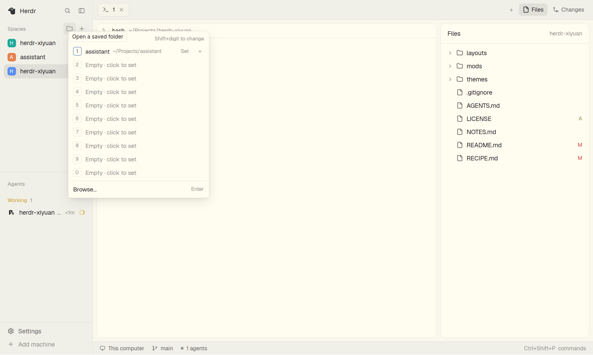

# Xiyuan

<!-- 一段话：使用者看到什么 -->

## What you see

<!-- 从上到下 / 从左到右的区域，尺寸、颜色、字体，各显示什么 -->

## How it behaves

<!-- agent 各状态（working / blocked / done / idle）的样子；点击、按键、悬停；什么会动 -->

## Built from

<!-- 节点树与 blocks、每个 mod 及其 props、用到的内置 mod、herdr 函数/命令、运行的外部程序、美术资源 -->

## Watch out

<!-- 踩坑、重建易错点、尺寸/数量限制、未实现的控件、对环境的假设 -->

## Done when

<!-- 证明构建成功的检查项 -->
